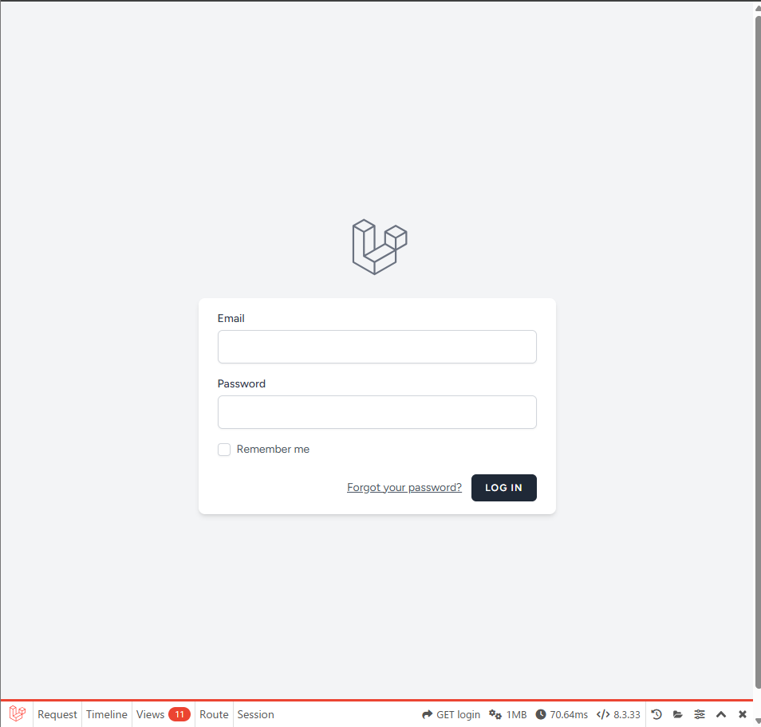
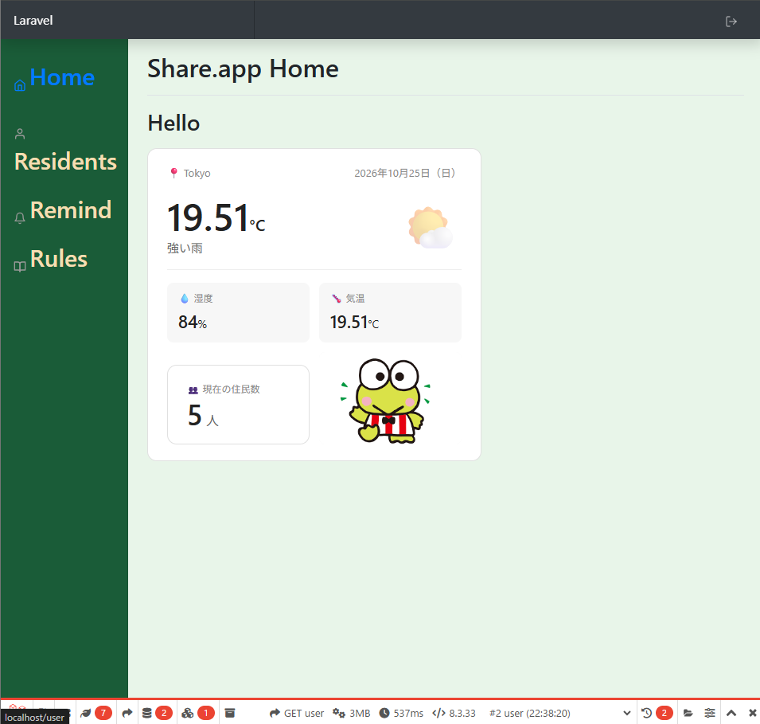
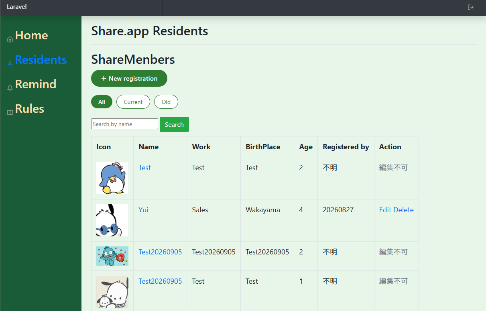
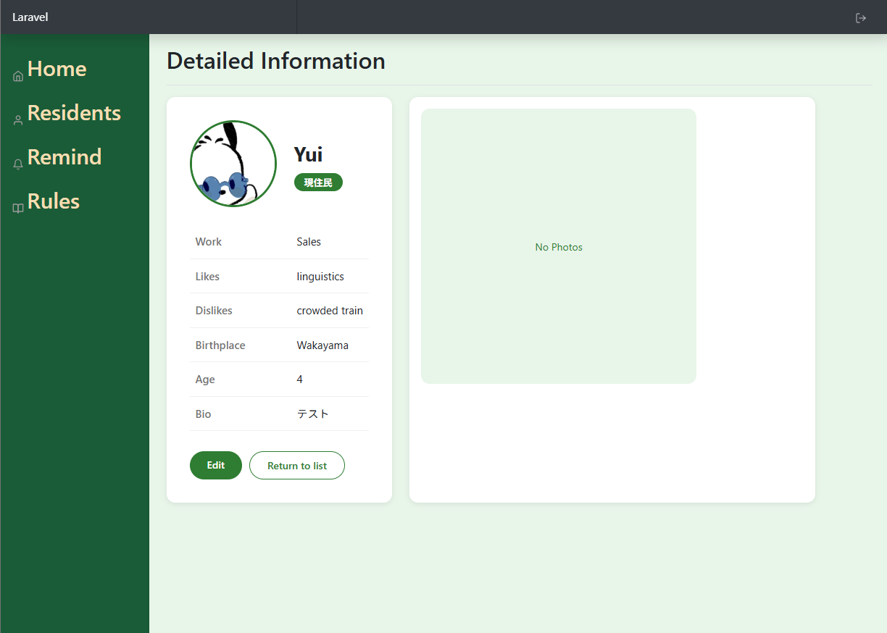
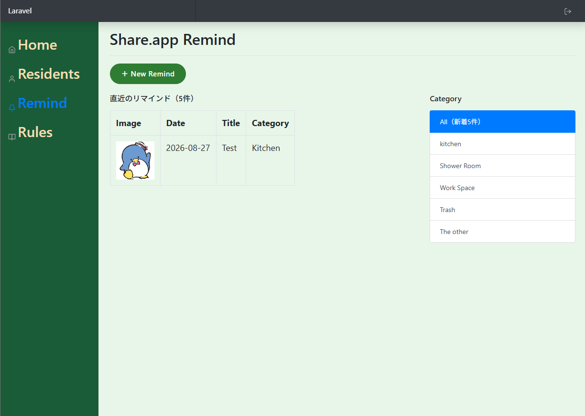
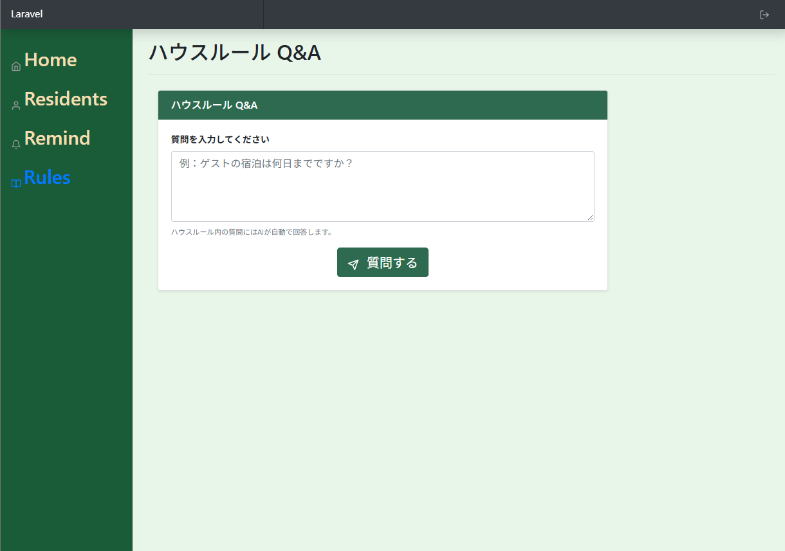

# アプリ概要
アプリ名：Share.app

概要：シェアハウス用の住民間の交流用のWEBアプリ

## 想定ユーザー

住民(一般ユーザー)
- 性別・国籍不問の50人規模のシェアハウスに住む20〜40代の住民

管理会社(管理ユーザー)
- 21個のシェアハウスを運営・管理する小規模のシェアハウス管理会社

## 技術スタック

| 項目 | 内容 |
|------|------|
| バックエンド | PHP 8.1/ Laravel 9 /FormRequest / Eager Loading /  |
| フロントエンド | Blade / CSS(Bootstrap) |
| データベース | MySQL / QueryBuilder |
| インフラ | Docker（Ubuntu環境） |
| 外部API | OpenWeatherMap API、LINE Messaging API |
| 認証 | Laravel Breeze |

---

# 実装機能

## 一般ユーザー側

- ログイン・認証機能
- 現住民のプロフィール一覧機能
- 自分のプロフィールの編集機能(画像追加・削除機能あり)
- 匿名でのリマインド投稿機能
- 一定量同じカテゴリのリマインドが溜まればグループLINEへの通知機能

## 管理ユーザー側
- ログイン・認証機能
- 新規住民の登録・削除機能
- 現住民・過去住民のプロフィール一覧機能

#　UI画面(一般ユーザー側)

### ログイン前画面(https://localhost/login)

### ログイン後 Home画面(https://localhost/user)

### 住民一覧画面(https://localhost/user/residents)

### 住民詳細画面(https://localhost/user/住民id番号)

### リマインド一覧画面(https://localhost/user/reminds)

### Q&A ページ画面(https://localhost/user/house_qa)

#　UI画面(管理ユーザー側)

## 工夫したポイント

EagerLoadを使用して使うクエリの本数を節約してパフォーマンス面を意識した開発を行った。

## 対応中
- LLM機能
- 詳細画面からの画像追加エラー対処
- PHPUnit によるテストの追加
- アカウント追加機能(現状DBから直接アカウント管理)